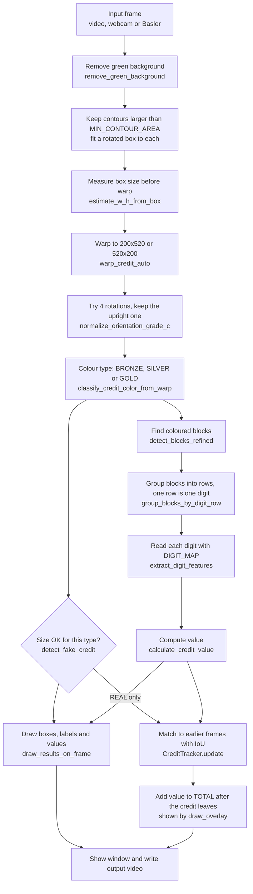

# Credit Detector

A machine-vision program (Python + OpenCV) that finds coloured "credit" cards on a
green conveyor belt, reads their digits, works out their value, spots fakes and
keeps a running total.


<!-- After pushing to GitHub, add the CI badge (replace <your-user>):

-->

University machine-vision project by **Group 12**. The code in
`credit_detector.py` is kept exactly as it was graded.

---

## Quick start

```bash
git clone https://github.com/<your-user>/credit-detector.git
cd credit-detector
python -m venv venv
source venv/bin/activate              # Windows: venv\Scripts\Activate.ps1
pip install -r requirements.txt

python credit_detector.py video examples/sample.mp4     # a video file
python credit_detector.py camera                        # your webcam
```

Press `q` to quit. Run `python credit_detector.py` with no arguments to see the help text.

---

## Table of contents

- [Quick start](#quick-start)
- [Features](#features)
- [Screenshots](#screenshots)
- [How it works](#how-it-works)
- [Digit encoding](#digit-encoding)
- [Value rules](#value-rules)
- [Worked examples](#worked-examples)
- [Fake detection](#fake-detection)
- [Tracking and total](#tracking-and-total)
- [Requirements](#requirements)
- [Installation](#installation)
- [Usage](#usage)
- [Keyboard controls](#keyboard-controls)
- [Configuration](#configuration)
- [Adjusting for your own setup](#adjusting-for-your-own-setup)
- [Project structure](#project-structure)
- [Running the tests](#running-the-tests)
- [Troubleshooting](#troubleshooting)
- [Known limitations](#known-limitations)
- [Contributing](#contributing)
- [Authors](#authors)
- [License](#license)

---

## Features

- Finds credits on a **green conveyor** by removing the green background.
- Sorts each credit into one of three types by colour: **BRONZE**, **SILVER** or **GOLD**.
- **Straightens** each credit (perspective warp) and turns it the **right way up**.
- **Reads the digits** from patterns of coloured blocks.
- Works out the **value** of each credit, with a different rule for each type.
- Marks credits as **FAKE** when their size is wrong for their type.
- **Tracks** credits from frame to frame so each one is counted only once.
- Shows a running **TOTAL CREDITS VALUE** on screen.
- Three input sources: **video file**, **webcam**, or **Basler industrial camera** (pypylon).
- Can **record** the annotated output to an `.mp4` file.
- Keyboard controls to pause, step one frame, show debug windows and save screenshots.

---

## Screenshots

> No screenshots yet. Add your own to [`docs/images/`](docs/images/) and link them here.

Suggested images:

| File | What it should show |
|---|---|
| `docs/images/main_window.png` | The main window with boxes, labels, values and the total |
| `docs/images/fake_credit.png` | A credit marked `FAKE` with its reason in red |
| `docs/images/debug_blocks.png` | A `Stage 4 - Blocks` debug window (press `d`) |

Then add them like this:

```markdown

```

Tip: press `s` while the program runs to save the current annotated frame as a PNG.

---

## How it works

Every frame goes through the same pipeline. The names in the boxes are the real
function names in `credit_detector.py`. For every detail and number, see
[docs/HOW_IT_WORKS.md](docs/HOW_IT_WORKS.md).



In short:

1. **Background removal.** Green pixels (in HSV) are the belt. Everything else is a possible credit.
2. **Find credits.** Shapes bigger than `MIN_CONTOUR_AREA` (8000 px) get a rotated box.
3. **Measure and straighten.** The box size is saved for the fake check, then the credit is warped to a flat 200 x 520 (or 520 x 200) image.
4. **Orientation.** All 4 rotations are scored. Portrait always wins over landscape, so the result is always 200 x 520. GOLD credits look for their "7-like" symbol at the top. The others prefer more colour at the top than at the bottom.
5. **Colour type.** Strongly coloured pixels vote for BRONZE, SILVER or GOLD. The winner needs more than 250 pixels, otherwise the type is `UNKNOWN`.
6. **Fake check.** The longer side is compared with `SIZE_THRESHOLDS`.
7. **Blocks, rows, digits.** Solid rectangles of the credit's colour are found, grouped into rows (one row = one digit, read top to bottom) and decoded with `DIGIT_MAP`.
8. **Value, tracking, total.** Digits become a value. Real credits are tracked, and their value is added to the total once they have left the view.

---

## Digit encoding

Each digit is one row of coloured blocks with **two columns**:

- **Column 1 (C1)** has one block. Its **height** carries information.
- **Column 2 (C2)** has 0 to 3 small blocks stacked on top of each other. **How many** there are carries information.

**C1 height class.** The height of the column-1 block is divided by the median
height of the column-2 blocks:

| Ratio (C1 height / C2 height) | C1 height class |
|---|---|
| less than 1.6 | **1** (short) |
| 1.6 to less than 3.2 | **2** (medium) |
| 3.2 or more | **3** (tall) |

If there are no column-2 blocks, the ratio is 1 (class 1).

**C2 pattern.** The column-2 blocks are counted (tiny ones are ignored) and the
pattern is filled from the top: 0 blocks = `(0,0,0)`, 1 = `(1,0,0)`, 2 = `(1,1,0)`, 3 or more = `(1,1,1)`.

### DIGIT_MAP

| Digit | C1 height class | C2 pattern | In words |
|:-:|:-:|:-:|---|
| **0** | 1 | (0, 0, 0) | short C1, no C2 blocks |
| **1** | 1 | (1, 0, 0) | short C1, 1 C2 block |
| **2** | 1 | (1, 1, 0) | short C1, 2 C2 blocks |
| **3** | 1 | (1, 1, 1) | short C1, 3 C2 blocks |
| **4** | 2 | (1, 0, 0) | medium C1, 1 C2 block |
| **5** | 2 | (1, 1, 0) | medium C1, 2 C2 blocks |
| **6** | 2 | (1, 1, 1) | medium C1, 3 C2 blocks |
| **7** | 3 | (1, 0, 0) | tall C1, 1 C2 block |
| **8** | 3 | (1, 1, 0) | tall C1, 2 C2 blocks |
| **9** | 3 | (1, 1, 1) | tall C1, 3 C2 blocks |

Easy way to remember: **digit = 3 x (C1 class - 1) + number of C2 blocks**.

A medium or tall C1 with no C2 blocks is not in the table. It gives `UNKNOWN`,
and that digit is **skipped** (the other digits are still used).

---

## Value rules

| Type | Rule | Example digits | Value | Shown on screen |
|---|---|---|---|---|
| **BRONZE** | Multiply the digits | 2, 3, 4 | **24** | `2 x 3 x 4 = 24` |
| **SILVER** | Join the digits into one number | 1, 2, 3 | **123** | `123` |
| **GOLD** | Join the digits, then multiply by 10 | 1, 2 | **120** | `12 x 10 = 120` |

If no digits are found, or the type is `UNKNOWN`, the credit has no value.

---

## Worked examples

**BRONZE credit, two rows.**

| Row | C1 | C2 blocks | Feature | Digit |
|---|---|---|---|---|
| 1 (top) | short | 2 | (1, (1,1,0)) | **2** |
| 2 | short | 3 | (1, (1,1,1)) | **3** |

BRONZE multiplies: 2 x 3 = **6**. The label is `BRONZE | REAL` and `2 x 3 = 6`.

**GOLD credit, two rows.**

| Row | C1 | C2 blocks | Feature | Digit |
|---|---|---|---|---|
| 1 (top) | medium | 1 | (2, (1,0,0)) | **4** |
| 2 | short | 2 | (1, (1,1,0)) | **2** |

GOLD joins and multiplies by 10: 42 x 10 = **420**. The label is `GOLD | REAL` and `42 x 10 = 420`.

**Same digits, other types.** Digits 4, 2 on a SILVER credit give **42**. On a BRONZE credit they give 4 x 2 = **8**.

**Fake.** A SILVER credit whose longer side is 780 px (limit 1050-1200 px) is shown
as `SILVER | FAKE` with `TOO_SMALL_SILVER` in red, and is not added to the total.

The BRONZE example and the fake example are checked by the automated tests on synthetic images (`tests/test_utils.py`).

---

## Fake detection

A credit is **FAKE** if its size is wrong for its type. The size is the **longer
side** of the rotated box, in pixels, measured **before** the warp. So the check
works in any rotation.

| Type | Real if the longer side is ... | Reason shown otherwise |
|---|---|---|
| SILVER | from **1050** to **1200** px | `TOO_SMALL_SILVER` / `TOO_LARGE_SILVER` |
| GOLD | at least **700** px | `TOO_SMALL_GOLD` |
| BRONZE | at most **800** px | `TOO_LARGE_BRONZE` |
| UNKNOWN | always real | - |

Limits are inclusive (a SILVER of exactly 1050 px is real).

Fake credits get **red** text with the reason and are **not** added to the total.

> **Important:** these numbers fit the camera height and resolution used in the
> course lab. For another setup see [Adjusting for your own setup](#adjusting-for-your-own-setup).

---

## Tracking and total

The `CreditTracker` (defaults `iou_threshold=0.15`, `max_age=30`) makes sure each
credit is counted once, even though it appears in many frames.

1. **Matching.** Each real credit is matched to an earlier track of the **same type**, using the overlap (**IoU**) of their boxes. The best match with IoU **above 0.15** wins. Each track can be matched only once per frame.
2. **New track.** If nothing matches, a new track is made.
3. **History.** Each track remembers every value it has read.
4. **Finalize.** When a track has not been seen for **more than 30 frames**, its value is added to the total and the track is removed:
   - GOLD: the **largest** value in its history.
   - BRONZE / SILVER: the largest **non-zero** value (or 0 if all values were 0).
   - A track that never had a value adds nothing.
5. **Display.** `TOTAL CREDITS VALUE: <n>` is drawn in a black bar at the bottom of the frame.

So the total goes up about 30 frames **after** a credit leaves the view
(3 seconds at 10 FPS, 1 second at 30 FPS). With `TRACKER_DEBUG = True` the console
shows `[NEW]`, `[MATCH]`, `[FINALIZE]` and `[STATE]` lines.

---

## Requirements

- Python **3.9 or newer** (tested on 3.9 to 3.12)
- `opencv-python` >= 4.5
- `numpy` >= 1.21
- A screen (the program opens an OpenCV window)
- Optional, for Basler cameras: `pypylon` >= 2.0

---

## Installation

```bash
git clone https://github.com/<your-user>/credit-detector.git
cd credit-detector
```

Make a virtual environment.

Linux / macOS:

```bash
python3 -m venv venv
source venv/bin/activate
```

Windows (PowerShell):

```powershell
python -m venv venv
venv\Scripts\Activate.ps1
```

Install the packages:

```bash
pip install -r requirements.txt
```

**Optional: Basler camera support.**

```bash
pip install -r requirements-basler.txt
```

- `pypylon` wheels include the pylon runtime on most systems. If the camera is still not found, install the **Basler pylon Camera Software Suite**. Its *pylon Viewer* is useful to check that the camera works.
- For GigE cameras, check the network settings (IP address, jumbo frames) with the pylon tools.
- Without `pypylon` the program still works for video and webcam. Only `basler` mode needs it.

---

## Usage

```bash
python credit_detector.py <mode> [arguments]
```

Run with no arguments to print the help text (the program then exits with code 1).

> The built-in help says `python script.py ...`. Use `credit_detector.py` instead.

| Command | Input | Notes |
|---|---|---|
| `python credit_detector.py video <file> [output]` | Video file | `<file>` is required |
| `python credit_detector.py camera [output]` | Webcam | Always camera index 0 |
| `python credit_detector.py basler [output]` | Basler camera | First camera found. Sets 10 FPS, exposure 8000 µs and gain 0 (auto off) |
| `python credit_detector.py <file> [output]` | Video file | Legacy shortcut |
| `python credit_detector.py <number> [output]` | Camera with that index | Legacy shortcut, e.g. `1` for a second webcam |

The mode words (`video`, `camera`, `basler`) are not case sensitive.

Examples:

```bash
python credit_detector.py video examples/sample.mp4
python credit_detector.py video examples/sample.mp4 result.mp4
python credit_detector.py camera webcam_rec.mp4
python credit_detector.py basler recording.mp4
python credit_detector.py 1                      # webcam with index 1
```

### Output video

If you give an `[output]` file name, the annotated frames are saved as MP4
(`mp4v` codec). For video and webcam, the FPS and frame size come from the source
(FPS falls back to 30). For Basler, the writer starts on the first frame at 10 FPS.

The saved video (and PNGs saved with `s`) contain the boxes, labels and total,
but **not** the green info text in the top-left corner.

### On-screen information

- Top-left: FPS, processing time per frame, number of credits in the frame, frame number, input mode, and `REC` when recording.
- Bottom: the running total.
- Each credit: type, `REAL` / `FAKE`, and the value (or the reason it has none).

### Console output

For each credit in each frame the console prints `Credit N: Pre-warp size: W x H`.
These numbers are useful for tuning `SIZE_THRESHOLDS`. Tracker messages are
printed too while `TRACKER_DEBUG = True`.

---

## Keyboard controls

Click on the video window first so it receives the key presses.

| Key | Action |
|---|---|
| `q` or `ESC` | Quit |
| `p` | Pause / resume |
| `SPACE` | Process one frame (only while paused) |
| `d` | Toggle debug mode (block windows and orientation scores in the console) |
| `s` | Save the current annotated frame as `frame_YYYYMMDD_HHMMSS.png` |

---

## Configuration

All settings are constants at the top of `credit_detector.py`. Change them in the file.

| Constant | Default | What it does |
|---|---|---|
| `GREEN_LOWER` / `GREEN_UPPER` | `[35,40,40]` / `[90,255,255]` | HSV range for the normal green belt |
| `GREEN_LOWER_BRIGHT` / `GREEN_UPPER_BRIGHT` | `[35,20,80]` / `[90,255,255]` | HSV range for bright, washed-out green (glare) |
| `MIN_CONTOUR_AREA` | `8000` | Smallest shape (px area) that counts as a credit |
| `TRACKER_DEBUG` | `True` | Print tracker messages to the console |
| `COLOR_CONFIG` | see below | HSV ranges for each type and the box colour (BGR) used for drawing |
| `DIGIT_MAP` | see [table](#digit_map) | Maps `(C1 class, C2 pattern)` to a digit |
| `SHOW_DEBUG_WINDOWS` | `False` | Start with debug mode on or off (also toggled with `d`) |
| `FRAME_SKIP` | `0` | `N` = process 1 frame, then skip `N` frames |
| `DISPLAY_SCALE` | `0.7` | Window size compared to the frame (does not change the saved video) |
| `SIZE_THRESHOLDS` | see [Fake detection](#fake-detection) | Pixel size limits for real credits |

HSV values use the OpenCV scale: H 0-179, S 0-255, V 0-255.

`COLOR_CONFIG` ranges:

| Type | Hue | Min S | Min V | Drawn in |
|---|---|---|---|---|
| BRONZE | 0-16 and 170-180 (red/orange wraps around 0) | 100 | 49 | orange |
| SILVER | 95-128 (blue) | 105 | 100 | blue |
| GOLD | 22-35 (yellow) | 100 | 100 | gold |

Some values are inside functions, not at the top: tracker `iou_threshold=0.15`
and `max_age=30` (`CreditTracker.__init__`), colour vote minimum `250` px and
saturation `> 80` (`classify_credit_color_from_warp`), block saturation `> 60`,
and Basler FPS / exposure / gain (`setup_basler_camera`).

---

## Adjusting for your own setup

The defaults were tuned for one lab: one camera, one height, one light. On a
different setup, change these constants in this order. Run a video, watch the
console and turn on debug (`d`) while you tune.

**1. Camera distance or resolution changed** (credits look bigger or smaller)

- `SIZE_THRESHOLDS`: read the `Pre-warp size` lines in the console for real
  credits of each type. Set the limits around the **longer** side you see, with
  some margin. Scale all limits by the same factor as the size change: for
  example, if credits are now half as big, halve every number.
- `MIN_CONTOUR_AREA`: area grows with the square of the size. If credits are
  half as big (in length), use about a quarter (8000 -> 2000). Too low lets
  noise in; too high misses credits.
- The block and row rules work on the warped 200 x 520 image, so they do not need changes.

**2. Lighting or belt colour changed**

- No credits found, or the whole frame is one big shape: tune the green ranges
  `GREEN_LOWER` / `GREEN_UPPER` and `GREEN_LOWER_BRIGHT` / `GREEN_UPPER_BRIGHT`.
  A shadowed belt needs a lower minimum V. A shiny belt needs a lower minimum S
  in the bright range.
- Wrong type, or `UNKNOWN`: tune the hue limits in `COLOR_CONFIG`. Warm light
  pushes yellow (GOLD) towards orange (BRONZE), so watch the border at hue 16 / 22.
- Missing blocks: in dim light lower the minimum V (and S) of that type in
  `COLOR_CONFIG`.

To find the right HSV numbers, save a frame with `s`, then check pixel values,
for example:

```python
import cv2
img = cv2.imread("frame_20250106_120000.png")
hsv = cv2.cvtColor(img, cv2.COLOR_BGR2HSV)
print(hsv[300, 400])   # H, S, V of the pixel at row 300, column 400
```

**3. Credits move faster or the camera is slower**

- If one credit is counted twice, the boxes overlap too little between frames.
  Process more frames per second (faster camera, `FRAME_SKIP = 0`), or pass a
  lower value with `CreditTracker(iou_threshold=...)` in `main()`.
- `max_age=30` is in frames. At a low FPS the total updates slowly. A smaller
  value updates faster but can split one credit into two if it is hidden for a moment.

**4. Basler camera settings**

- Exposure (8000 µs), gain (0) and 10 FPS are set in `setup_basler_camera`.
  Change them if the image is too dark, too bright or blurred.

> Changing these values changes the behaviour from the graded version. Do it in
> your own fork or branch (see [CONTRIBUTING.md](CONTRIBUTING.md)).

---

## Project structure

```
credit-detector/
├── credit_detector.py          # The whole program (pipeline, tracker, CLI)
├── requirements.txt            # Core packages
├── requirements-basler.txt     # Core + pypylon for Basler cameras
├── requirements-dev.txt        # For tests: headless OpenCV + pytest
├── pyproject.toml              # pytest settings only (not a package)
├── tests/
│   └── test_utils.py           # Unit, end-to-end and CLI tests
├── docs/
│   ├── HOW_IT_WORKS.md         # Every pipeline step with exact numbers
│   └── images/                 # Screenshots for the README
├── examples/
│   └── README.md               # Where to put sample videos (not in git)
├── .github/workflows/tests.yml # Runs the tests on Python 3.9-3.12
├── CHANGELOG.md
├── CONTRIBUTING.md
├── LICENSE                     # MIT
└── README.md
```

---

## Running the tests

The tests do not need a camera, a screen or pypylon.

```bash
pip install -r requirements-dev.txt
pytest
```

They cover:

- the helper functions (`order_points`, `estimate_w_h_from_box`, `rotate90`,
  `calculate_credit_value`, `detect_fake_credit`, `DIGIT_MAP`,
  `extract_digit_features`, `classify_credit_color_from_warp`,
  `remove_green_background`, `detect_blocks_refined`, `group_blocks_by_digit_row`, `box_iou`),
- full runs of `process_frame` on synthetic frames (a BRONZE 2 x 3 = 6 credit,
  a SILVER credit in portrait and landscape, a too-small SILVER fake),
- the tracker rules (IoU threshold, same type only, `max_age` boundary, value rules),
- the command line (help text, missing arguments, missing file).

GitHub Actions runs them on every push and pull request.

> Do not install `opencv-python` and `opencv-python-headless` in the same
> environment for normal use. They can conflict. Use a separate venv for tests.

---

## Troubleshooting

| Problem | What to try |
|---|---|
| `ERROR: Could not open: Video: ...` | Check the file path. Make sure OpenCV can read the codec (try converting to H.264 MP4). |
| `ERROR: Could not open: Webcam 0` | Another program may be using the webcam. Try another index with the legacy shortcut, e.g. `python credit_detector.py 1`. |
| `ERROR: pypylon library not installed.` | `pip install -r requirements-basler.txt` |
| `ERROR: No Basler camera detected.` | Check cable and power. Open *pylon Viewer* to see if the camera is found. Close other programs using the camera. |
| `Frame rate config failed` / `Exposure config failed` | Some camera models use other property names. The program keeps running with the camera's own settings. |
| No credits are found | The belt may not match the green range, or credits are smaller than `MIN_CONTOUR_AREA`. See [Adjusting for your own setup](#adjusting-for-your-own-setup). |
| Whole frame is one big credit | Too little of the belt is seen as green. Widen the green HSV ranges or improve the lighting. |
| All credits are FAKE (or none are) | `SIZE_THRESHOLDS` do not match your camera distance. Read the `Pre-warp size` lines and adjust. |
| Wrong type (e.g. BRONZE seen as GOLD) | Lighting changes the hue. Tune `COLOR_CONFIG`. |
| Wrong or missing digits | Turn on debug (`d`) and look at the `Stage 4 - Blocks` windows: they show the blocks found on the straightened card. Blocks closer than 10 px to the card edge are ignored. |
| `RULE_VIOLATION` on a `REAL` credit | No digits could be read. See Known limitations. |
| Total does not go up | A credit is added only after it has been gone for more than 30 frames. |
| Window does not respond to keys | Click on the video window first. |
| `cv2.imshow` error / no window | You may have `opencv-python-headless` installed. Uninstall it and install `opencv-python`. |
| Saved `.mp4` will not play | Not every player supports `mp4v`. Try VLC. |

---

## Known limitations

The code is kept exactly as it was submitted for the course, so these issues
are documented here and **not** fixed.

- **Credits still visible at the end are not counted.** A credit is added to the total only after it has been missing for more than 30 frames. When the video ends (or you quit), credits still being tracked are never added, so the final total can be too low.
- **A Basler grab timeout stops the program.** `RetrieveResult` waits 2000 ms and then throws an exception. The main loop catches it, prints the error and exits instead of retrying.
- **`RULE_VIOLATION` on real credits.** If a credit is real but no value could be read, its second line shows `RULE_VIOLATION` (in the credit's colour) even though the first line says `REAL`. `UNKNOWN` credits always show this.
- **Help text says `script.py`.** The usage text was written before the file was renamed. Use `credit_detector.py`.
- **Turning debug off while paused hides the main window.** Turning debug off calls `cv2.destroyAllWindows()`, which also closes the main window. It comes back when the next frame is processed (resume, or press `SPACE`).
- **Size thresholds are in pixels.** Fake detection only works for the camera height and resolution it was tuned for.
- **`mask &=` leaves 0/1 values.** In `detect_blocks_refined`, `mask &= (hsv[:, :, 1] > 60)` turns the mask values into 0 and 1 instead of 0 and 255. It still works, because OpenCV treats any non-zero pixel as foreground, but the mask looks black if you display it.
- **`REC` can show when nothing is recorded.** For video and webcam, the writer is kept even if it failed to open, so `REC` is shown anyway. (Basler checks this and prints a warning.)
- **Lighting sensitive.** All segmentation uses fixed HSV ranges. Strong glare, shadows or a different belt colour need re-tuning.
- **Tracking needs overlap.** Fast movement, low FPS, or a type that flickers between frames creates new tracks and can count one credit twice.
- **Skipped digits.** A row that decodes to `UNKNOWN` is dropped, so a credit can get a wrong value instead of no value.
- **Webcam index is fixed.** `camera` mode always uses index 0. Use the legacy shortcut (`python credit_detector.py 1`) for other cameras.
- **Global side effects on import.** Importing the module turns off all Python warnings and sets `PYLON_CAMEMU=0`.
- **Single file, no packaging.** All code is in one script. It cannot be installed with `pip install .`.

---

## Contributing

Documentation fixes, tests and screenshots are welcome. Please do not change the
detection logic in the main branch. See [CONTRIBUTING.md](CONTRIBUTING.md).

---

## Authors

**Group 12** - university machine-vision group project (Credit Detection Team).

---

## License

Released under the [MIT License](LICENSE). Copyright (c) 2025 Group 12.
